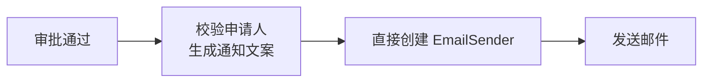
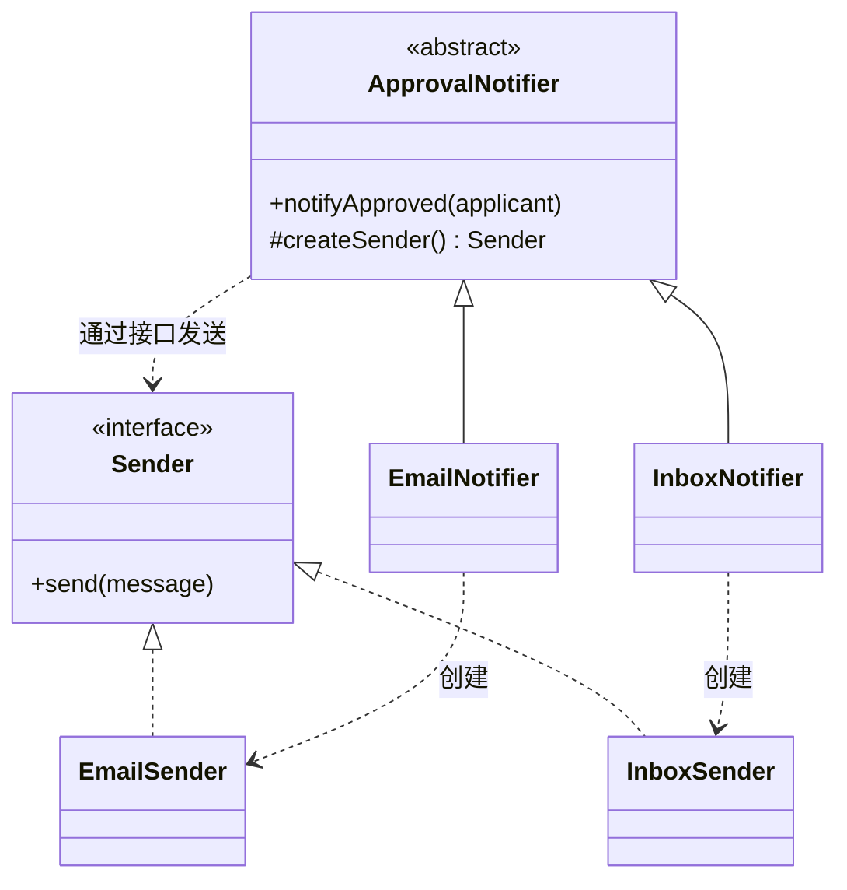
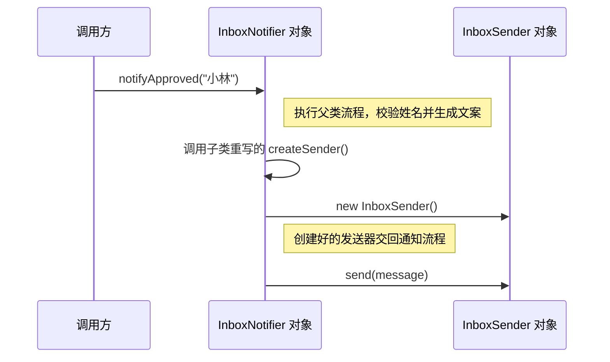

# 工厂方法模式

## 审批通知原来只发邮件

小林的申请通过了，系统给他发了一封邮件，内容是「小林，你的申请已通过」。后来，审批系统要多支持一种渠道。有些通知继续发邮件，有些要出现在站内消息里。



原来的代码写到发送这一步，就直接 `new EmailSender()`。如果给站内消息也复制一份流程，今天只要换个发送器就能跑。可下次把「申请已通过」改成「审批已完成」，同一条文案就得改两遍。

## 在发送前，先拿到合适的发送器

既然校验和文案都一样，就把它们留在 `ApprovalNotifier` 的 `notifyApproved()` 里。写到发送这一步，先调用 `createSender()` 拿到一个发送器，再把文案交给它的 `send()` 方法。

邮件版的 `EmailNotifier` 把 `createSender()` 写成返回 `EmailSender`，站内版的 `InboxNotifier` 则返回 `InboxSender`。两种发送器都实现了 `Sender`，所以 `notifyApproved()` 可以用同一行 `sender.send(message)` 发出通知。



图里的「创建」箭头从两个子类出发，父类只需要认识 `Sender`。这种由父类声明创建方法、由子类决定返回什么对象的写法，就是**工厂方法模式（Factory Method）**。按原文的叫法，`ApprovalNotifier` 是「创建者」，`Sender` 是「产品」的接口。[Refactoring.Guru 工厂方法模式](https://refactoringguru.cn/design-patterns/factory-method)

## 小林收到站内消息时，代码怎么走？

同一条通知要发到站内时，程序会先选 `InboxNotifier`，再调用它的 `notifyApproved("小林")`。



图里 `createSender()` 的箭头指回了 `InboxNotifier` 自己。`notifyApproved()` 的代码虽然写在父类里，执行这段代码的仍是当前这个 `InboxNotifier` 对象。换成 `EmailNotifier`，同样的调用就会拿到 `EmailSender`。

## 用 Java 跑一次

把代码存为 `FactoryMethodDemo.java`，用 JDK 11 或更新版本运行。两个发送器会把通知打印到控制台，方便对照同一条文案走邮件和站内消息时的结果。

```java
interface Sender {
    void send(String message);
}

class EmailSender implements Sender {
    @Override
    public void send(String message) {
        System.out.println("邮件通知：" + message);
    }
}

class InboxSender implements Sender {
    @Override
    public void send(String message) {
        System.out.println("站内通知：" + message);
    }
}

abstract class ApprovalNotifier {
    public void notifyApproved(String applicant) {
        if (applicant == null || applicant.isBlank()) {
            throw new IllegalArgumentException("申请人不能为空");
        }

        String message = applicant.strip() + "，你的申请已通过。";
        Sender sender = createSender();
        sender.send(message);
    }

    protected abstract Sender createSender();
}

class EmailNotifier extends ApprovalNotifier {
    @Override
    protected Sender createSender() {
        return new EmailSender();
    }
}

class InboxNotifier extends ApprovalNotifier {
    @Override
    protected Sender createSender() {
        return new InboxSender();
    }
}

public class FactoryMethodDemo {
    public static void main(String[] args) {
        ApprovalNotifier email = new EmailNotifier();
        ApprovalNotifier inbox = new InboxNotifier();

        email.notifyApproved("小林");
        inbox.notifyApproved("小林");
    }
}
```

```bash
javac -encoding UTF-8 FactoryMethodDemo.java
java FactoryMethodDemo
```

```text
邮件通知：小林，你的申请已通过。
站内通知：小林，你的申请已通过。
```

## 如果还要加短信呢？

加一个 `SmsSender`，再让 `SmsNotifier` 的 `createSender()` 返回它，最后在选择通知渠道的入口接上短信选项。以后审批文案再改，还是在 `notifyApproved()` 里改一次。

这种做法每加一种渠道就要多写一个 `Notifier` 子类。如果手头只是根据渠道参数拿一个发送器，用 `SenderFactory.create(channel)` 集中选择通常就够了。这种写法通常叫**简单工厂**。

## 参考资料

- 原文通过物流和对话框示例讲解这个模式。[Refactoring.Guru 工厂方法模式](https://refactoringguru.cn/design-patterns/factory-method)
- 对话框示例展示了 `Dialog` 如何通过 `createButton()` 获取不同平台的按钮。[Refactoring.Guru Java 代码示例](https://refactoringguru.cn/design-patterns/factory-method/java/example)
